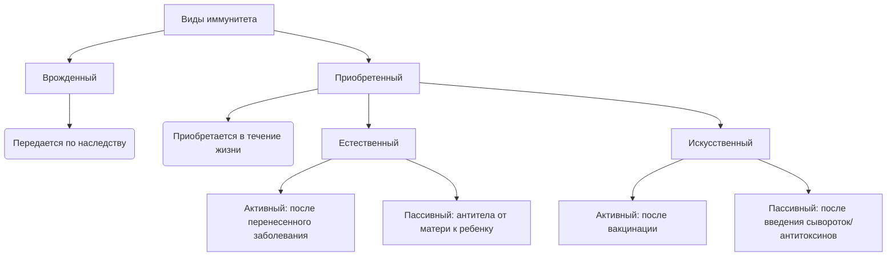

# ЧС биолого-социального характера

> [!abstract] Метаданные лекции
> **Дата:** 20.11.2026
> **Место:** Воронежский государственный университет (ВГУ). Кафедра безопасности жизнедеятельности и основ военной подготовки.

## 1. Биологическая безопасность и национальная безопасность РФ

Биологическая безопасность в современных условиях является неотъемлемой частью **национальной безопасности** страны. 

> [!quote] Правовая база
> Согласно Федеральному закону от 30.03.1999 № 52-ФЗ «О санитарно-эпидемиологическом благополучии населения»:
> *«Санитарно-эпидемиологическое благополучие населения — состояние здоровья населения, среды обитания человека, при котором отсутствует вредное воздействие факторов среды обитания на человека и обеспечиваются благоприятные условия его жизнедеятельности».*

### Факторы дестабилизации биологической безопасности:
1.  **Инфекционная патология** (основной фактор).
2.  **Глобализация:** возрастание туристических и миграционных потоков создает реальные угрозы трансграничного переноса возбудителей.
3.  **Биологический терроризм (биотерроризм):** приводит одновременно к людским, политическим и экономическим потерям.

> [!warning] Важная статистика
> Блок биолого-социальных опасностей разнообразен и обширен. Если в структуре **всех ЧС** в России он занимает **менее 10%**, то доля **пострадавших** от этих опасностей составляет почти **60%**.

**ЧС биолого-социального характера** — это обстановка на определенной территории, сложившаяся в результате воздействия биологического фактора, при которой нарушаются нормальные условия жизнедеятельности людей, существования сельскохозяйственных животных и растений, возникает угроза жизни и здоровью людей, потери сельскохозяйственных животных и растений.

## 2. Патогенные микроорганизмы: основы микробиологии

*Источником биологических ЧС являются инфекционные заболевания людей, животных, растений.*

Инфекционные болезни отличаются от всех других тем, что вызываются **живыми возбудителями**. Из бесчисленного количества микроорганизмов только патогенные обладают свойством вызывать инфекционное заболевание.

### Классификация микробов по приспособленности:
| Тип микробов | Характеристика | Примеры / Условия |
| :--- | :--- | :--- |
| **Условно-патогенные** | В обычных условиях вреда не приносят. Активизируются при снижении иммунитета. | Облучение радиацией, охлаждение, голодание, переутомление, стресс (например, ангина). |
| **Патогенные** | Вызывают заразные заболевания. Являются паразитами (живут и размножаются в живых организмах). | Возбудители инфекций человека, животных и растений. |

### Ключевые понятия патогенности:
*   **Патогенность** — это *видовой, генетически обусловленный* признак. Это способность вызывать заболевание, которая сформировалась у возбудителей в результате длительной эволюции (тысячелетия приспособления к макроорганизмам).
*   **Вирулентность** — это *фенотипический* признак. Это **количественное выражение патогенности**.
    *   *Повышается:* при многократном пассировании через организм восприимчивых животных.
    *   *Понижается:* под воздействием неблагоприятных факторов (высокая температура, антимикробные и дезинфицирующие вещества, пассирование через невосприимчивых животных).

## 3. Эпидемиологические термины и масштабы распространения

*   **Спорадическая заболеваемость** — заболеваемость в какой-либо местности, удерживающаяся на одном уровне в виде единичных случаев на протяжении нескольких лет.
*   **Групповые инфекции** — заболевания, связанные единым источником инфицирования, возникшие в одном населенном пункте, коллективе или хозяйстве (например, корь в детском саду, заболевания животных на ферме).
*   **Эндемия** — инфекционная заболеваемость, свойственная населению определенной местности.

### По виду (объекту) инфекционные заболевания подразделяют:
1.  **Эпидемии** — широкое распространение одноимённых инфекционных болезней среди людей (превышает обычный уровень).
2.  **Эпизоотии** — инфекционные болезни животных (наличие специфического возбудителя, цикличность, передача от зараженного к здоровому).
3.  **Эпифитотии** — инфекционные болезни растений (например, ржавчина, мучнистая роса).
4.  **Пандемия** — необычайно большое распространение заболеваемости с охватом ряда стран, целых континентов и даже всего земного шара.

*(В лекции приведены фото-примеры: Эпидемия (люди в масках), Эпизоотия (туши свиней), Эпифитотия (больные растения), Зооноз (человек в защитном костюме с птицей).)*

## 4. Инфекционный процесс и заболевание

*   **Возбудитель** — патогенный микроорганизм, эволюционно приспособившийся к паразитированию в организме и потенциально способный вызывать заболевание.
*   **Инфекция** (лат. *infecio* — заражение) — внедрение и размножение в организме болезнетворных микроорганизмов, сопровождающееся комплексом реактивных процессов.
*   **По природе возбудителей** инфекции бывают: вирусные, бактериальные, грибковые, протозойные, смешанные. *(У людей лидируют вирусы: грипп, ветряная оспа. У растений — грибковые).*

**Инфекционный процесс** — это взаимодействие (борьба) между макроорганизмом и микроорганизмом. 
> [!info] Исходы инфекционного процесса
> 1. Гибель возбудителя.
> 2. Возникновение инфекционного заболевания.
> 3. Взаимная адаптация (здоровое бациллоносительство).

### Периоды течения инфекционного заболевания:
1.  **Инкубационный (скрытый):** от внедрения до первых признаков. Возбудитель размножается и накапливается.
    *   *Длительность:* от нескольких часов (грипп, ОКИ) до недель (дифтерия, корь) и даже лет (СПИД, бешенство).
2.  **Продромальный (начальный):** общие проявления (недомогание, озноб, температура, головная боль). Длится 2-4 дня.
3.  **Период основных проявлений:** специфические симптомы. (Несколько дней — несколько недель).
4.  **Период угасания:** симптомы исчезают, но сохраняется слабость и утомляемость.
5.  **Реконвалесценция (выздоровление):** полное исчезновение симптомов, восстановление работоспособности.

*(Возможен переход в хроническую форму или бактерионосительство).*

## 5. Эпидемический очаг и три звена эпидемического процесса

*   **Зона (очаг) биологического заражения** — территория, в пределах которой возможно заражение людей.
*   **Эпидемический очаг** — место нахождения источника инфекции с окружающей территорией, в пределах которой может распространяться возбудитель (квартира, детский сад, школа, вагон).
*   **Эпидемический процесс** — непрерывная цепь следующих друг за другом заражений и заболеваний.

> [!important] Три звена (фактора) эпидемического процесса
> Для распространения инфекции необходимы **все три** звена:
> 1.  **Источник инфекции** (организм зараженного человека или животного, в котором идет сохранение и размножение возбудителя).
> 2.  **Механизм передачи** возбудителей.
> 3.  **Восприимчивое население**.
> 
> *Если выпадает хотя бы одно звено, новые случаи заболеваний не возникают.*

### Классификация инфекций по источнику:
*   **Антропонозы:** источник — человек.
*   **Зоонозы:** источник — животное (человек может быть «тупиком» в цепи, не заражая других).
*   **Антропо-зоонозы:** источник — и человек, и животное (например, чума).

**Специфические особенности возбудителей:** специфичность, эпидемичность, высокая токсичность, контагиозность, наличие инкубационного периода, возможность консервации, дальность распространения (пандемии), трудность экспресс-индикации, сильное психологическое воздействие.

## 6. Пути передачи инфекции

По механизму действия их объединяют в четыре группы:
1.  **Воздушно-капельный / воздушно-пылевой** (аэрогенный, респираторный).
2.  **Фекально-оральный** (водно-пищевой).
3.  **Контактный:** 
    *   *Прямой:* половой путь передачи венерических болезней.
    *   *Непрямой:* через внешние предметы (детские игрушки, кожевенно-меховые изделия).
4.  **Кровяной (трансмиссивный):** 
    *   Через промежуточного носителя (членистоногие: вши, блохи, клещи, комары, мухи).
    *   Через нестерилизованный инструментарий (шприцы, иглы).

## 7. Иммунитет

**Иммунитет** — невосприимчивость организма к инфекциям. Инфекционные болезни отличаются тем, что выздоравливающий организм приобретает иммунитет к данному заболеванию. Иммунитет бывает **стойким** и **нестойким**.

## 8. Методы борьбы с массовыми заболеваниями

Мероприятия по профилактике проводятся по трем направлениям: обезвреживание источника, разрыв путей передачи, повышение устойчивости макроорганизма.

### По времени осуществления:
*   **Профилактические:** планомерные и постоянные (предупреждение возникновения).
*   **Противоэпидемические:** экстренные (в случае возникновения процесса).

### По масштабам:
*   **Государственные (обязательные, караются законом):** санэпиднадзор, социальные меры, карантин.
*   **Индивидуальные:** касаются отдельного человека, не обязательны, но влияют на общую заболеваемость.

> [!check] Комплекс противоэпидемических мероприятий в очаге:
> - [ ] Санитарно-эпидемиологическая разведка и наблюдение.
> - [ ] Режимно-ограничительные мероприятия (**обсервация** и **карантин**).
> - [ ] Экстренная неспецифическая и специфическая профилактика.
> - [ ] Использование индивидуальных и коллективных средств защиты.
> - [ ] Лечебно-эвакуационные мероприятия.
> - [ ] Обеззараживание (дезинфекция, дезинсекция, дератизация).
> - [ ] Санитарная обработка лиц, находившихся в очаге.

*(В период стихийных бедствий и катастроф резко ухудшаются социально-бытовые условия, что обостряет эпидемическую ситуацию. Потенциальные источники инфекции оказываются неизолированными, имеют многочисленные контакты с людьми).*

## 9. Исторические вспышки смертельных болезней в СССР

> [!danger] Чума (Москва, 1939 год)
> **Нулевой пациент:** Врач-микробиолог Абрам Берлин. Работал с живым возбудителем чумы в Саратове, но был вызван в Москву, нарушив строгий карантин. Остановился в гостинице «Националь», посетил ресторан и парикмахерскую.
> **Развитие:** Почувствовав себя плохо, был госпитализирован с ошибочным диагнозом крупозной пневмонии. 
> **Спасение:** Дежурный врач клиники 1-го Московского медицинского института Симон Горелик определил легочную чуму, немедленно сообщил наверх и изолировался вместе с Берлиным (оба знали, что обречены, так как чуму тогда не умели лечить).
> **Итог:** НКВД отыскало всех контактеров, клиника была оцеплена, гостиницу дезинфицировали по ночам. Эпидемию остановили в зародыше. Погибли только трое: Горелик, Берлин и парикмахер.

> [!danger] Черная (натуральная) оспа (Москва, 1959 год)
> **Нулевой пациент:** Художник Алексей Кокорекин. Вернулся из Индии, где присутствовал на церемонии сожжения брахмана и заразился. 
> **Развитие:** Обратился за помощью с лихорадкой и кашлем, врачи ошибочно поставили диагноз «грипп», хотя больной покрылся сыпью. Умер через 3 дня. О вспышке узнали спустя две недели, когда начали заболевать контактировавшие лица.
> **Масштабы:** В карантин поместили **9342 человека**. Оцепили Боткинскую больницу (для запертых сотрудников вскрыли неприкасаемый госзапас белья на случай войны). 
> **Ликвидация:** Провели беспрецедентную в истории поголовную вакцинацию. За неделю врачи круглосуточно привили более **9 миллионов** человек в Москве и области.
> **Итог:** Всего заболело 45 человек, трое скончались. Через 19 дней больных не осталось. 
> *(События легли в основу повести А. Мильчакова «В город пришла беда» и одноименного фильма 1966 года).*

## 10. Дезинфекция (обеззараживание)

**Дезинфекция** — уничтожение патогенных микробов в окружающей человека среде.

### Виды дезинфекции:
*   **Профилактическая:** проводится регулярно, независимо от наличия заболеваний. (Обеззараживание сточных вод, мусора, уборка помещений, мытье рук, пастеризация молока). *Можно проводить своими силами.*
*   **Очаговая:** 
    *   *Текущая:* у постели больного.
    *   **Заключительная:** проводится однократно после госпитализации, выздоровления или смерти больного (преимущественно при ООИ). Проводят центры дезинфекции с обязательным использованием СИЗ (респиратор, перчатки, защитный костюм).

### Методы дезинфекции:
1.  **Механические:** проветривание, влажная уборка, удаление пыли, мытье рук.
2.  **Физические:** солнечный свет, УФ-лучи, водяной пар, горячий воздух, накаливание металла, кипячение, сжигание мусора.
3.  **Химические:** применение химических средств (хлорная известь, хлорамин, фенол, лизол, формалин, сулема, кислоты, щелочи).
4.  **Биологические:** применение микробов-антагонистов для уничтожения болезнетворных штаммов (при обеззараживании сточных вод, мусора).

> [!tip] Правило выбора метода
> При выборе метода дезинфекции необходимо учитывать: **тип возбудителя**, простоту и доступность метода, место локализации возбудителя. При лечении больного на дому все дезинфекционные мероприятия должны выполняться в полном объеме.
